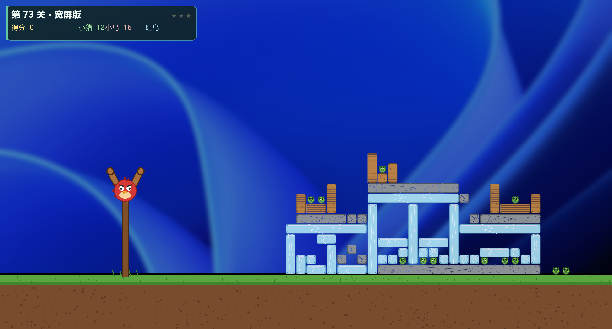
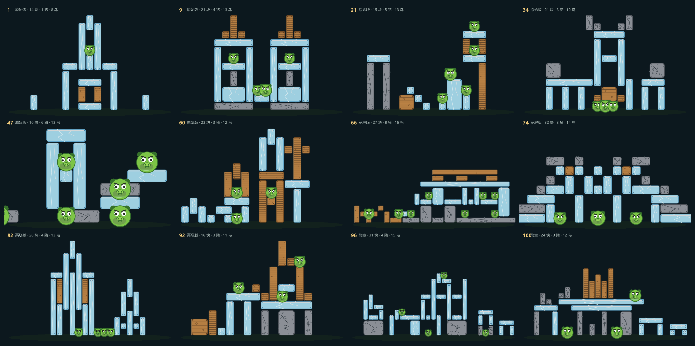

# 桌面图标版愤怒的小鸟

把 Windows 桌面变成愤怒的小鸟弹弓场：桌面图标就是你的小鸟，也是城堡里的小猪，拖拽、瞄准、松手，把木屋和石头城堡里的“猪”砸掉。

窗口标题：**Desktop version of Angry Birds**



## 玩法

- 按住弹弓上的**桌面图标小鸟**，向后拖动，松手发射。
- 鼠标拖动时会显示虚线弹道；拖得越远，发射力度越大。
- 砸中小猪、木块、石块和 TNT 会得分；清空所有小猪即可过关，剩余小鸟会奖励分数。
- 特殊小鸟：**炸弹鸟**飞行中点击引爆，**分裂鸟**飞行中点击一变三；待发射队列和弹弓上的鸟都会显示浮动提示（“会爆炸”/“1变3”）。
- 顶部工具栏可用数字框直接跳关（共 100 关），另有重玩、上一关、下一关、隐藏游戏或退出。
- `Esc` 退出；`Ctrl+Alt+X` 是全局退出热键（游戏悬停在桌面时也有效）。

## 关卡设计

100 关全部来自原版《愤怒的小鸟》的真实关卡布局：把原版的 12×15 / 12×30 格关卡矩阵逐格读入，同材质的相连格子合并成整面墙、整根梁（原版本身就是这么站的），悬空的材质团先落地，再按屏幕尺寸等比缩放。前 60 关是原版前三章，61 关起是宽屏章节和高塔章节，越往后楼层越高、猪越靠里，最高的一关叠到十几层、近百块构件。

原版矩阵只记录了材质和猪的位置，所以每关的小鸟数量、分数阈值由这里推导：按实测需要的发射数给足小鸟，二星只要过关，三星还要把废墟砸够。



## 下载

Windows 免安装单文件版：[GitHub Releases](https://github.com/eosed/desktop-version-of-angry-birds/releases/latest)。下载 `DesktopAngryBirds.exe` 直接运行。

## 运行

要求 Windows 10/11、Python 3.10+。

```bat
python -m pip install -r requirements.txt
python app.pyw
```

也可以双击 `run.cmd`。

## 实现方式

- **真实桌面图标作为小鸟和猪**：通过 Windows Shell (`SHCreateItemFromParsingName` + `IImageFactory`) 提取图标缩略图，不截图、不复制文件；小鸟来自桌面快捷方式，小猪来自其他桌面应用图标，弹弓后方的待发射队列也会显示接下来的真实图标。
- **真实桌面壁纸作为场景**：通过 `IDesktopWallpaper` 读取当前壁纸并按 Windows 的填充方式渲染到主显示器工作区，保留“桌面就是游戏场地”的感觉。
- **桌面覆盖层**：用分层子窗口（`WS_EX_LAYERED`，挂在 Explorer 的 `SHELLDLL_DefView` 下）绘制游戏，并暂时隐藏真实图标列表；退出或崩溃恢复时重新显示。
- **物理**：`pymunk` 刚体、重力、碰撞冲量与可破坏结构；木头耐打、冰一撞就碎、石头最硬；一百套原版关卡按屏幕尺寸缩放。
- **十几层的高塔能站住**：原版关卡是几十个矩形靠极小接触面垒起来的，开局先做 400 步静置，静置期间冻结转动惯量（方块不会互相顶翻），第一只鸟撞上城堡的瞬间解冻，之后就是正常的刚体；`step()` 再按 1/150 秒切片，避免大塔在长帧里被“挤爆”。
- **崩溃恢复**：独立 watchdog 进程监视游戏进程；主机异常退出时自动恢复桌面图标显示。
- **布局安全**：使用 overlay-only 模式，不移动、不修改用户真实的桌面图标位置。

## 项目结构

```
app.pyw              入口（含 watchdog 分发）
dab/
  game.py            pymunk 物理、得分与状态机
  levels.py          关卡矩阵转构件、星级与鸟数
  original_levels.py 原版 100 关的矩阵数据
  overlay.py         桌面分层窗口渲染与鼠标瞄准
  icons.py           Shell 图标缩略图提取
  shell.py           桌面图标列表与布局快照/恢复
  wallpaper.py       读取并渲染当前 Windows 壁纸
  art.py             Pillow 程序化美术
  ui.py              Tk 工具栏与生命周期
  runner.py          60fps 渲染线程
  watchdog.py        崩溃后恢复桌面
tests/test_game.py   无窗口物理/通关回归测试
```

## 测试

```bat
python -m unittest discover -s tests -v
```

覆盖：全部 100 关静置 6 秒不自行倒塌；全部 100 关都有确定性通关脚本；炸弹鸟与分裂鸟能力回归测试。

## 来源与许可

关卡数据来自 [AdeelZafar123/AngryBirdsDataSet](https://github.com/AdeelZafar123/AngryBirdsDataSet)（原版关卡截图矩阵，仓库未附许可证，此处仅作关卡布局转录并注明来源）。《愤怒的小鸟》商标与关卡设计版权归 Rovio Entertainment 所有，本项目是非商业的桌面玩具复刻。

本项目复用了 [liuxiaogang-com/desktop-icon-billiards](https://github.com/liuxiaogang-com/desktop-icon-billiards) 的桌面覆盖层、Shell 布局会话、图标缩略图、DPI/看门狗等基础设施，并在其基础上实现了愤怒的小鸟玩法、物理、关卡、美术和工具栏。

上游项目为 MIT 许可，Copyright (c) 2025-2026 LXG。本项目同样以 MIT 许可发布，完整文本见 [LICENSE](LICENSE)。

## 已知限制

- 仅支持 Windows；以主显示器工作区为游戏场地。
- 桌面图标必须处于显示状态；如果系统设置为隐藏桌面图标，游戏会拒绝启动并提示先显示图标。
- 游戏运行时会隐藏真实桌面图标列表，画面由覆盖层绘制；退出后自动恢复。
